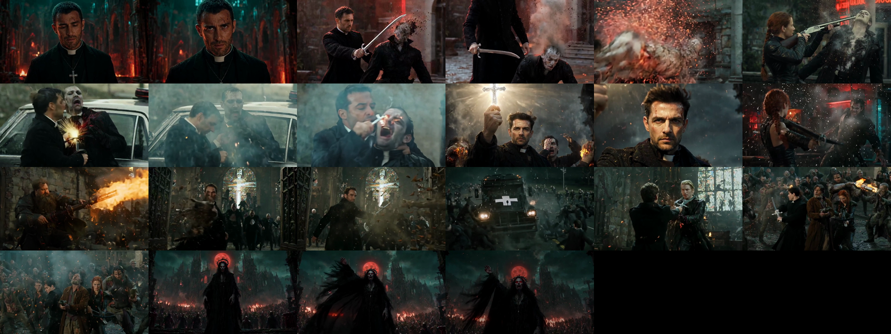

# Ultron Engine

A **local AI video studio**: keyframe images, image-to-video with native speech, music with vocals, voice cloning, lip-sync QA and a scripted edit step, all driven by one engine and a set of Claude Code skills. Built and measured on an Apple M3 Ultra (96 GB). Nothing needs a cloud service; if your machine is too small, `setup` lets you send heavy parts to a rented GPU instead.


*A 44 s action trailer made entirely with this engine's LTX route (original characters, one still per shot, about 2 min of generation per shot).*

## What you get
| Capability | Models (details in [docs/MODELS.md](docs/MODELS.md)) |
|---|---|
| Image-to-video, native speech, up to 10 s | LTX-2.5 (MLX), MiniMax-H3 (MLX, better action, slower) |
| Keyframes and identity-keeping edits | Qwen-Image 2.1, Qwen-Image-Edit 2511, Mage-Flow Turbo |
| Music with vocals | ACE-Step 1.5 XL Turbo |
| Voice clone and voice conversion | Fish Audio S2 Pro (research licence), Chatterbox (MIT), Qwen3-TTS |
| Speech check, word timestamps | Whisper large-v3-turbo |
| Lip-sync (optional) | LatentSync 1.5 |
| Edit and render | ffmpeg and HyperFrames (HTML to video) |
| QA tools (`src/tools`) | face match (ArcFace), clip QA gate, lip-sync metric, pause trimming, heavy-job memory guard |

## Quick start
```bash
git clone <this repo> ultron-engine && cd ultron-engine
python3 ultron.py setup        # asks: local, cloud GPU, or mixed -> then asks before EVERY model download
python3 ultron.py doctor
```
If you use **Claude Code**, just open the folder and say "set this up": [CLAUDE.md](CLAUDE.md) makes the assistant ask you the same questions (local / cloud / mixed, per component) and confirm each download with the file name, source and real size before it starts.

Read [docs/QUICKSTART.md](docs/QUICKSTART.md) for your first video.

## Honest status
- **Tested on one machine** (M3 Ultra, 96 GB, macOS). Local models are **MLX builds: Apple Silicon only**. On NVIDIA/Linux use the cloud route.
- **Cloud GPU support is experimental**: the adapter protocol and a worker template are here ([docs/CLOUD.md](docs/CLOUD.md)), but we have not run it against a real provider and the template contains no model code.
- Some models are large (LTX about 43 GB, H3 about 70 GB) and need a lot of RAM: [docs/HARDWARE.md](docs/HARDWARE.md).
- The Apple MLX port of LatentSync we use is not included; lip-sync is optional (LTX speaks natively).
- Models have their own licences, some non-commercial: [docs/LICENSES.md](docs/LICENSES.md). Fan content of copyrighted characters is for private use only.

## Documentation
[QUICKSTART](docs/QUICKSTART.md) | [ARCHITECTURE](docs/ARCHITECTURE.md) | [MODELS](docs/MODELS.md) | [HARDWARE](docs/HARDWARE.md) | [CLOUD](docs/CLOUD.md) | [MEMORY_AND_QUEUE](docs/MEMORY_AND_QUEUE.md) | [PROMPTING](docs/PROMPTING.md) | [RESULTS](docs/RESULTS.md) | [LICENSES](docs/LICENSES.md) | [skills/](skills)
