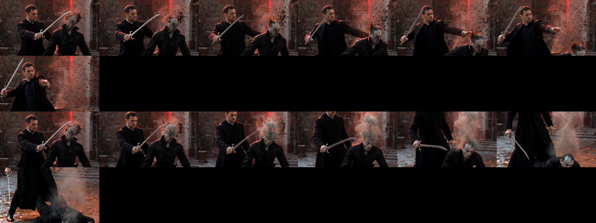

# Prompting LTX for action (tested 2026-10-16, same still and seed, old vs new prompt)

Top row: effect-list prompt. Bottom row: beat prompt. The bottom plays as swing, stagger, collapse, step back.

Rules (the full skill is `skills/studio-ltx-video/SKILL.md`):
1. Do not re-describe the still; say what **changes**. Present tense, one flowing paragraph, 60-110 words.
2. **One dominant event and at most two chained beats per 4 s** (use "as / then / while"): wind-up, impact, reaction.
3. **Block the space**: "priest on the left, vampire on the right".
4. Describe the **physical result** of every hit (head dissolves into ash, body staggers then buckles, sparks fly toward the camera) and secondary motion (coat snaps, rain streaks).
5. **Camera locked or slow handheld push-in.** Never "orbits / drifts around": a duel prompt with "drifts left around the priest" jumped to a different room and a different man.
6. No negations ("no X" tends to create X), no crowds, one hero and one opponent.
7. Frames are 8k+1; the first frame is copied, so a photoreal start matters.

Sources we read: the RunDiffusion and ltxworkflow LTX prompt guides.
Example shot lists and prompts: `src/pipelines/shots.py`.
